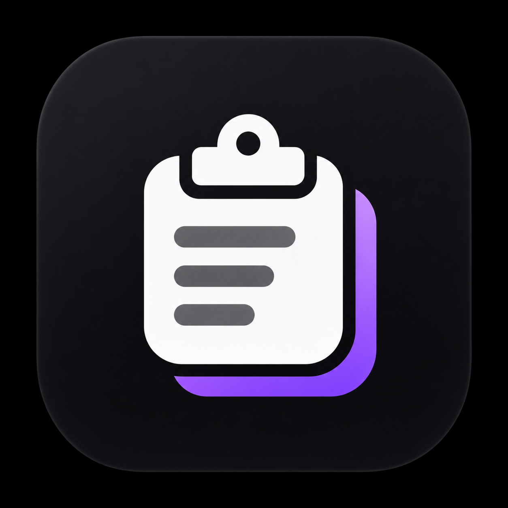

# Echo



A lightweight, native macOS clipboard history app. Find a previous clip, press Return, and paste it into the app you were using.

## Features

- Keeps your latest 300 text and image clips locally on your Mac.
- Search history and filter by text or images.
- Compact, resizable popup near the text caret, with a mouse-position fallback.
- Navigate clips with arrow keys and paste with Return or a click.
- Customizable global shortcut; defaults to **⌘⇧V**.
- Native light and dark appearance, keyboard focus indicators, and accessible controls.
- Settings and history clearing from the popup or menu bar.

## Requirements

macOS 13 or later and Apple's Swift toolchain (Xcode or Command Line Tools).
There are no third-party package dependencies.

## Build and run

```sh
git clone https://github.com/bufferBrew/echo.git
cd echo
./build.sh
open /Applications/Echo.app
```

The script builds a release binary, assembles and signs `Echo.app`, and installs it in `/Applications`. To build without installing:

```sh
./build.sh --no-install
open Echo.app
```

## Usage

1. Launch Echo; it lives in the menu bar.
2. Copy text or an image in any app.
3. Place the caret in your destination and press **⌘⇧V**, or click Echo's menu bar icon.
4. Search, use **↑/↓** to select a clip, then press **Return** to paste. Clicking a clip also pastes it.
5. Press **Escape** to dismiss, **⌘F** to focus search, or **⌘,** to open settings.

Automatic paste requires **System Settings → Privacy & Security → Accessibility → Echo**. Without permission, selecting a clip still copies it to the clipboard so you can paste with **⌘V**. Ad-hoc builds can require granting permission again after rebuilding; see [stable local signing](SIGNING.md).

## Local storage

History and images are stored in `~/Library/Application Support/Echo`. History is persisted as JSON and images as PNG files. The app has no network service or account; clips stay on your Mac. Clear saved clips using **Clear History…** in Echo's menu.

## Navigation checks

```sh
swiftc Sources/Echo/ClipboardItem.swift Sources/Echo/HistoryViewModel.swift Tests/main.swift -o /tmp/echo-navigation-tests
/tmp/echo-navigation-tests
```

These checks cover filtering, search, selection bounds, and reopening state. Cross-app paste also requires a manual check in an editable destination with Accessibility permission enabled.
